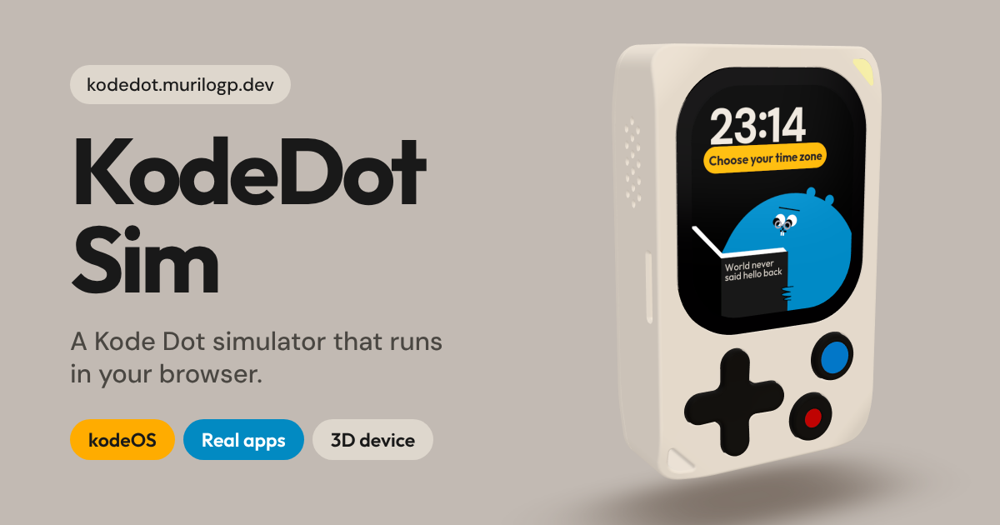
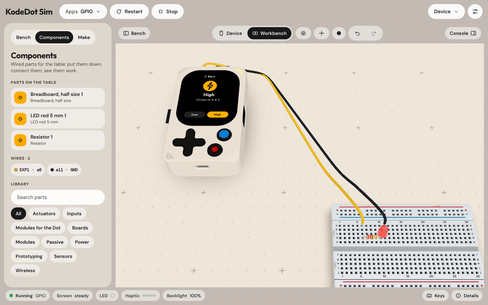

# KodeDot Sim

The Kode Dot handheld, running in your browser: the real kodeOS and real kode-sdk apps, compiled from their source code to WebAssembly, on a page with a bench of things to put near the Dot and a 3D workbench to wire parts to it.

**Live: https://kodedot.murilogp.dev**



This is a community project by Murilo; it is not made by Kode.

## What you can do with it

- Use the Dot: unlock kodeOS, open its apps, change its settings. The screen takes clicks and touches, the buttons press, and the keyboard works too.
- Put things near it: an NFC tag, an RFID card, a router, a TV and its remote, a microSD card, a charger, a Bluetooth sensor and phone, a computer on a USB cable.
- Wire things to it on the workbench: parts, a breadboard, Kode's Maker and Robotics modules, and Arduino and ESP32 boards whose sketches are compiled in the browser.
- Run your own app: build a kode-sdk app folder into an app package and drop it on the page.



## For visitors: nothing to install

Open https://kodedot.murilogp.dev in Chrome (or a browser built on it). The page has a **Guide** in its top bar: how to use the Dot, the bench and the workbench, what is simulated and what is not. Each section has its own link, for example https://kodedot.murilogp.dev/#guide/your-own-app.

Everything stays in your browser: the Dot's settings, files and apps, and your bench. There is no account and no server.

## Run the site locally

You need Node.js 22 and npm.

```
cd web
npm install
npm run dev        # the page, with the headers the WebAssembly threads need
npm test           # unit tests
npm run build      # type check and production build into web/dist
npm run preview    # serves web/dist with the production headers
```

The first `npm run dev` or `npm run build` also builds the in-browser sketch compiler's files (about two minutes, about 125 MB under `build/`, fetched from the npm registry). The Dot's own software is committed prebuilt under `web/public/apps/`, and the parts library under `parts/prebuilt/`, so the page needs no other toolchain.

## Build an app package from a kode-sdk app

An app package is a zip with the app compiled to WebAssembly, the scripts that start it and stand in for the hardware, and the app's appdata (name, version, icon). `tools/dotbench` makes it from an ordinary kode-sdk app folder, such as one started from [Kode's app template](https://github.com/kodediy/kode-app-template). The same source builds for the real Dot with Kode's SDK.

You need git, bash, Python 3 with Pillow (`pip install pillow`), about 2.5 GB of disk and, for the set-up only, a network connection.

```
git clone https://github.com/murilogpapa/kodedot-sim
cd kodedot-sim
tools/setup.sh                        # once: kode-sdk, KodeOS, LVGL and Emscripten 7.0.0 into .deps/
source .dotbench-env                  # in every new terminal
tools/dotbench sdk                    # once: precompiles the SDK (about ten minutes on two cores)
tools/dotbench build path/to/my_app   # prints the path of the app package it wrote, under build/apps/my_app/
```

Drop that file on the page, or install it from the page's **Apps** menu.

This has been run on Linux (Ubuntu 24.04, x86-64), from a fresh clone to an app opened on the page. macOS and Windows have not been tried.

The tool compiles the C sources listed in the app's `main/CMakeLists.txt`; components of the app outside `main/` are not built.

## Repository layout

| Folder | What it holds |
|---|---|
| `web/` | The page: Vite, React, TypeScript, Tailwind. The device in 3D and 2D, the bench, the workbench, the code editor, the guide (`web/src/guide/`), the texts in English, Portuguese and Spanish |
| `runtime/` | The C side and its glue: a FreeRTOS API on Emscripten threads (`rtos/`), a minimal ESP-IDF surface (`idf/`), the shared state between firmware and page (`bridge/`), storage that survives a reload (`persist/`), one folder per hardware area with its web stand-in (`drivers/<area>/`), the JavaScript that loads and runs a package (`web-adapter/`), the in-browser sketch compiler (`cc/`) |
| `tools/` | `dotbench`, the build tool (`sdk`, `build <app-dir>`, `part ...`), and `setup.sh` |
| `apps/` | The ten starter apps that come installed (Light, NFC, RFID, IR Remote, Wi-Fi, Bluetooth, GPIO, Level, Files, Sound) |
| `parts/` | The parts library: one folder per part, and `prebuilt/` with the built packages the page serves |
| `templates/component-starter/` | The starter folder for a part of your own, with its manual |
| `tests/` | Node and browser test suites |
| `docs/` | The design, and one `STATUS-*.md` per piece saying what it really does, with the commands that prove it |
| `third_party/` | Vendored code (see Licence) |

## Add a part

A part is a folder with a `manifest.json` (identity, picture, size, pins, fields, behaviour), a picture, optionally an Arduino sketch, and test scenarios.

For a part of your own, to import on the page:

```
tools/dotbench part new my-part       # a copy of templates/component-starter (add --declarative for a no-code part)
tools/dotbench part check my-part
tools/dotbench part test my-part
tools/dotbench part build my-part     # writes my-part/<id>-<version>.dotpart
```

Then import the file in the page's **Make** tab. The page needs the part's size (`body`) and a position in millimetres (`mm`) for every pin; the starter does not have them yet, so add them. The part commands need Node.js 22 or newer; a part with a sketch also needs Emscripten (installed by `tools/setup.sh`).

For a part in the site's own library, add its folder under `parts/` (the library also asks for keywords in the three languages and a test scenario), then rebuild the committed packages:

```
cd web
npm run parts:regen    # rebuilds parts/prebuilt (needs Emscripten)
npm run parts:check    # what a deploy runs: fails when parts/prebuilt is stale
```

`docs/component-api.md` is the full reference; `docs/STATUS-parts.md` says what the parts engine models and what it does not.

## Licence

GPL-3.0-or-later, as kode-sdk and QP/C, on which the Dot's software is built.

Bundled software and where it comes from:

- kodeOS, Kody Kart and the two SDK examples are built unmodified from Kode's public repositories; `web/public/apps/SOURCES.md` lists each with its commit.
- `third_party/ArduinoCore-API` (LGPL-2.1-or-later; two of its headers are MIT) and `third_party/cJSON` (MIT) are vendored unmodified, each with its licence file.
- The in-browser sketch compiler is LLVM, Clang and LLD built for WebAssembly by YoWASP, with libc++ and wasi-libc; `runtime/cc/licenses/` holds their notices and licence texts, and they are served with the compiler's files.

The device model: `web/public/device/model.glb` is Kode's own 3D model of the Kode Dot, optimised for the web from the model shown on Kode's site; `web/public/device/NOTICE-model.md` credits it and says what was changed. The front render and its geometry under `web/public/device/` come from kode-sdk, under GPL-3.0-or-later (`web/public/device/NOTICE.md`).

Kode and Kode Dot are Kode's names; the device's design is Kode's.

## Problems and questions

Open an issue: https://github.com/murilogpapa/kodedot-sim/issues
